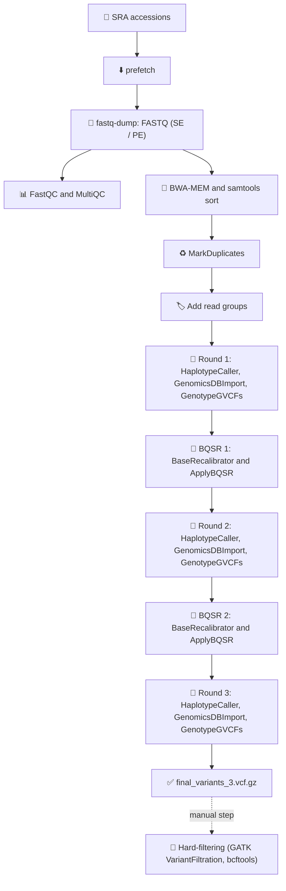

<div align="center">

# 🧬 VariFlow

**A reproducible Snakemake pipeline for SNP and indel discovery from public SRA data, using GATK4 with iterative base-quality recalibration**


</div>

---

## 📑 Table of contents

- [📖 Overview](#-overview)
- [✨ Key features](#-key-features)
- [🗺️ Workflow](#️-workflow)
- [🧩 Pipeline stages](#-pipeline-stages)
- [📁 Repository structure](#-repository-structure)
- [⚙️ Requirements](#️-requirements)
- [🛠️ Installation](#️-installation)
- [🔧 Configuration](#-configuration)
- [▶️ Usage](#️-usage)
- [📦 Output files](#-output-files)
- [🧹 Variant filtering](#-variant-filtering)
- [🌿 Case study: ginger](#-case-study-ginger-zingiber-officinale)
- [🔍 Troubleshooting](#-troubleshooting)
- [⚠️ Known limitations](#️-known-limitations)
- [📚 Citation](#-citation)
- [📝 License](#-license)
- [🙋 Contact](#-contact)

---

## 📖 Overview

**VariFlow** takes public **SRA run accessions** and a **reference genome** and produces a **jointly genotyped VCF** of SNPs and indels.

It is designed for **non-model organisms that have no known-variant database** (no dbSNP-style resource). GATK's base quality score recalibration (BQSR) needs a set of known variants, so VariFlow *bootstraps* one: variants called in one round are used as the known-sites for the next, over **three rounds of variant calling and two rounds of BQSR**.

VariFlow was developed and run end to end on ginger (*Zingiber officinale*, reference `GCF_018446385.1`, Zo_v1.1) using six public whole-genome sequencing samples. The reference genome and sample lists are set in a config file, so it can be reused for other species.

## ✨ Key features

- 🔁 **Iterative BQSR bootstrapping**: 3 rounds of variant calling, 2 rounds of recalibration
- 🧬 **Mixed library types**: single-end (SE) and paired-end (PE) samples handled in one run and joint-genotyped together
- ⬇️ **Starts from accessions**: downloads from SRA, so no manual FASTQ handling
- 📊 **Automatic QC**: FastQC and MultiQC reports for the raw reads
- 📦 **Reproducible software**: each rule runs in its own conda environment (`--use-conda`)
- 🧾 **Per-rule logs** for the main steps
- 🧪 **Validated** end to end on real ginger WGS data

## 🗺️ Workflow



## 🧩 Pipeline stages

| # | Stage | Tool | Rule file | Main output |
|---|-------|------|-----------|-------------|
| 1 | ⬇️ Download | SRA Toolkit `prefetch` | `download.smk` | `sra/<id>/<id>.sra` |
| 2 | 📄 Convert | `fastq-dump` | `fasterq.smk` | `fastq/` |
| 3 | 📊 QC | FastQC, MultiQC | `fastqc_se.smk`, `fastqc_pe.smk`, `multiqc.smk` | `fastqc/`, `multiqc/` |
| 4 | 📚 Reference prep | BWA, samtools, GATK | `reference.smk` | `.bwt` (BWA index), `.fai`, `.dict` |
| 5 | 🔗 Align | BWA-MEM, samtools sort | `align.smk` | `aligned/<id>.sorted.bam` |
| 6 | ♻️ Deduplicate | GATK MarkDuplicates | `dedup.smk` | `aligned/<id>.markdup.bam` |
| 7 | 🏷️ Read groups | GATK AddOrReplaceReadGroups | `rg.smk` | `aligned/<id>.rg.bam` |
| 8 | 🧬 Round 1 calling | HaplotypeCaller, GenomicsDBImport, GenotypeGVCFs | `gvcf_r1.smk` | `variants/final_variants_1.vcf.gz` |
| 9 | 🎯 BQSR 1 | BaseRecalibrator, ApplyBQSR | `bqsr.smk` | `bqsr1/<id>.recal.bam` |
| 10 | 🧬 Round 2 calling | HaplotypeCaller, GenomicsDBImport, GenotypeGVCFs | `gvcf_r2.smk` | `variants_r2/final_variants_2.vcf.gz` |
| 11 | 🎯 BQSR 2 | BaseRecalibrator, ApplyBQSR | `bqsr2.smk` | `bqsr2/<id>.recal.bam` |
| 12 | 🧬 Round 3 calling | HaplotypeCaller, GenomicsDBImport, GenotypeGVCFs | `gvcf_r3.smk` | `variants_r3/final_variants_3.vcf.gz` |

## 📁 Repository structure

```
VariFlow/
├── 📄 README.md
├── 📄 LICENSE
├── 📄 .gitignore
├── 🐍 Snakefile                  # global settings, rule all, includes
├── ⚙️ config/
│   └── config.example.yaml       # copy to config.yaml (git-ignored)
├── 📦 envs/                      # conda environments (bwa, gatk, samtools, sra, fastqc, multiqc, ...)
├── 📜 rules/                     # one .smk file per stage
│   ├── download.smk   fasterq.smk
│   ├── fastqc_se.smk  fastqc_pe.smk  multiqc.smk
│   ├── reference.smk  align.smk      dedup.smk  rg.smk
│   ├── gvcf_r1.smk    gvcf_r2.smk    gvcf_r3.smk
│   ├── bqsr.smk       bqsr2.smk
│   └── optional/                 # not included in the Snakefile
│       ├── trimming.smk          # fastp read trimming
│       └── fastqc_trimmed.smk    # QC of trimmed reads
└── 🖼️ docs/                      # figures and example results
```

## ⚙️ Requirements

| Requirement | Notes |
|-------------|-------|
| 🐧 Linux | Developed on Ubuntu 22.04 (workstation) and WSL2 (laptop) |
| 🐍 Conda or Mamba | [Miniforge](https://github.com/conda-forge/miniforge) recommended |
| 🐍 Snakemake | v9.16.3 used. Install with `mamba install -c conda-forge -c bioconda snakemake` |
| 💾 Disk | Several hundred GB, depending on the number and size of samples |
| 🧠 Memory | GATK jobs use `-Xmx8G` and 8 threads per job |

Tool versions used for the ginger results (each installed automatically per rule with `--use-conda`):

| Tool | Version | Role |
|------|---------|------|
| Snakemake | 9.16.3 | Workflow orchestration |
| Conda | 26.1.1 | Environment management |
| FastQC | 0.11.9 | Raw read quality assessment |
| MultiQC | 1.33 | Aggregated QC report |
| BWA (BWA-MEM) | 0.7.17 | Read alignment |
| SAMtools | 1.13 | BAM sorting and indexing |
| GATK | 4.4.0.0 | Duplicate marking, read groups, BQSR, variant calling |
| BCFtools | 1.13 | Post-run filtering and statistics |

## 🛠️ Installation

```bash
git clone https://github.com/ParvathiShareth/VariFlow.git
cd VariFlow
cp config/config.example.yaml config/config.yaml   # then edit it
```

## 🔧 Configuration

Edit `config/config.yaml`:

```yaml
reference: "/path/to/reference/genome.fna"
data_dir:  "outputs"

se_samples:
  - SRR36323020
  - SRR12116557
pe_samples:
  - SRR10739563
  - SRR12329118
  - SRR36323019
  - ERR4180116
```

| Key | Description |
|-----|-------------|
| `reference` | Path to the reference FASTA (`.fna`). The BWA index, `.fai` and `.dict` files are created next to it |
| `data_dir` | Directory for downloads, intermediate files and results. Use `outputs` (see the note below) |
| `se_samples` | SRA run accessions of single-end libraries |
| `pe_samples` | SRA run accessions of paired-end libraries |

> ⚠️ **Use `data_dir: "outputs"`.** The download and single-end FastQC rules currently write to a fixed `outputs/` folder, so other values of `data_dir` break the file paths between steps. Making these paths follow `data_dir` is on the to-do list.

### 🧭 GenomicsDB intervals file

The GenomicsDBImport rules read a list of contigs, one per line, that is **not created automatically**. Make it from the reference index before the first run:

```bash
mkdir -p data/reference
cut -f1 /path/to/reference/genome.fna.fai > data/reference/genome.intervals

# round 2 looks for the file under data_dir as well
mkdir -p outputs/data/reference
cp data/reference/genome.intervals outputs/data/reference/genome.intervals
```

For genomes with many scaffolds, restrict the list to the main chromosomes to speed up GenomicsDBImport.

## ▶️ Usage

```bash
# 🔎 1. Dry run: check the job graph without running anything
snakemake -n --use-conda --cores 8

# 🚀 2. Run the pipeline (produces the round 3 gVCFs for every sample)
snakemake --use-conda --cores 8

# 🧬 3. Joint-genotype the round 3 gVCFs into the final VCF
snakemake --use-conda --cores 8 outputs/variants_r3/final_variants_3.vcf.gz
```

Step 3 is separate because `rule all` stops at the per-sample gVCFs. The final genotyping line in the Snakefile is commented out.

**🔄 Resuming a long run**

```bash
snakemake --use-conda --cores 8 --rerun-incomplete --keep-going
```

**🖼️ Draw the workflow graph** (needs graphviz)

```bash
mkdir -p docs
snakemake --dag | dot -Tpng > docs/dag.png
```

## 📦 Output files

Everything is written under `data_dir`:

```
outputs/
├── 📥 sra/                     downloaded .sra files
├── 📄 fastq/                   raw reads
├── 📊 fastqc/  multiqc/        QC reports
├── 🔗 aligned/                 sorted, duplicate-marked and read-group BAMs
├── 🧬 variants/                round 1 gVCFs, GenomicsDB, final_variants_1.vcf.gz
├── 🎯 bqsr1/                   round 1 recalibration tables and BAMs
├── 🧬 variants_r2/             round 2 gVCFs, final_variants_2.vcf.gz
├── 🎯 bqsr2/                   round 2 recalibration tables and BAMs
├── 🧬 variants_r3/             round 3 gVCFs and ✅ final_variants_3.vcf.gz
└── 🧾 logs/                    logs per rule and sample
```

## 🧹 Variant filtering

VariFlow's final VCF is **unfiltered**. Because ginger has no curated variant database for VQSR, hard filters were applied to the final call set as a separate step after the pipeline, following GATK recommendations for organisms without such resources:

| Annotation | Threshold | Meaning |
|------------|-----------|---------|
| QD | < 2.0 | Low variant confidence relative to depth |
| FS | > 60 | Strong strand bias (FisherStrand) |
| MQ | < 40 | Poor mapping quality at the site |
| SOR | > 3 | Strand bias (odds ratio) |
| MQRankSum | < −12.5 | Mapping quality imbalance, ref vs alt reads |
| ReadPosRankSum | < −8.0 | Alt-allele reads clustered at read ends |

```bash
gatk VariantFiltration \
    -R /path/to/reference/genome.fna \
    -V outputs/variants_r3/final_variants_3.vcf.gz \
    -O outputs/variants_r3/final_variants_3.flagged.vcf.gz \
    --filter-name "QD2"       --filter-expression "QD < 2.0" \
    --filter-name "FS60"      --filter-expression "FS > 60.0" \
    --filter-name "MQ40"      --filter-expression "MQ < 40.0" \
    --filter-name "SOR3"      --filter-expression "SOR > 3.0" \
    --filter-name "MQRS-12.5" --filter-expression "MQRankSum < -12.5" \
    --filter-name "RPRS-8"    --filter-expression "ReadPosRankSum < -8.0"

# keep PASS records only
bcftools view -f PASS outputs/variants_r3/final_variants_3.flagged.vcf.gz \
    -Oz -o outputs/variants_r3/final_variants_3.PASS.vcf.gz

# summary statistics, including the Ti/Tv ratio
bcftools stats outputs/variants_r3/final_variants_3.PASS.vcf.gz > docs/variant_stats.txt
```

> 💡 These are generic GATK values. Check the annotation distributions of your own data before relying on them, especially with few samples.

## 🌿 Case study: ginger (*Zingiber officinale*)

**Reference:** `GCF_018446385.1` (Zo_v1.1), a chromosome-level assembly of about 3.1 Gb.

**Data:** six public Illumina whole-genome sequencing runs from leaf tissue, downloaded from NCBI SRA.

| Accession | Library type | Tissue |
|-----------|--------------|--------|
| SRR10739563 | Paired-end | Leaf |
| SRR12329118 | Paired-end | Leaf |
| SRR36323019 | Paired-end | Leaf |
| ERR4180116 | Paired-end | Leaf |
| SRR36323020 | Single-end | Leaf |
| SRR12116557 | Single-end | Leaf |

**Result after hard-filtering (PASS records):**

| Metric | Value |
|--------|-------|
| Polymorphic sites | 6,720,824 |
| SNPs | 4,021,084 |
| Indels | 2,702,163 |
| Multiallelic sites | 46,477 |
| Ti/Tv ratio | 2.30 |

A Ti/Tv ratio of 2.30 is within the 2.0–2.5 range expected for genome-wide SNP sets in plants, which indicates that true polymorphisms dominate the call set.

**Run environment:** HP Z2 Tower G9 workstation, Ubuntu 22.04, Intel Core i9-14900 (24 cores), 32 GB RAM.

> The multi-sample VCF is too large for GitHub. Summary statistics and figures are in [`docs/`](docs/).

## 🔍 Troubleshooting

| Problem | Likely cause and fix |
|---------|----------------------|
| `MissingInputException` for the reference | Check that `reference` in `config.yaml` points to an existing FASTA |
| `MissingInputException` for `genome.intervals` | Create the intervals file as shown in [GenomicsDB intervals file](#-genomicsdb-intervals-file) |
| `conda: command not found` | Install Conda or Mamba and activate it before running with `--use-conda` |
| Rules fail to find `outputs/sra/...` | Set `data_dir: "outputs"` in the config |
| Everything wants to re-run after editing rules | Normal Snakemake behaviour after code changes. Check the plan with `snakemake -n --rerun-triggers mtime` |
| Out of memory in GATK steps | Lower `--cores`, or reduce `-Xmx8G` in the rules |
| Disk full | Delete old `.sra` files and intermediate BAMs you no longer need |
| `Paired files not generated` | The accession is probably single-end. Move it to `se_samples` |
| `*Zone.Identifier` files appear | Windows download markers. Delete them: `find . -name "*Zone.Identifier" -delete` |

## ⚠️ Known limitations

- 🧪 Tested on one species (ginger) and six samples. Other organisms have not been tested.
- 🧹 Hard-filtering is a separate manual step and is not yet a Snakemake rule.
- 🧭 The GenomicsDB intervals file must be created by hand.
- 📁 Some rules use a fixed `outputs/` path, so `data_dir` should be `outputs`.
- ⚙️ GATK memory (`-Xmx8G`) and the BQSR `--maximum-cycle-value 1000` are set inside the rules, not in the config.
- 🎚️ Hard-filter thresholds are generic GATK recommendations and are not tuned to the organism.
- 🔁 BQSR round 2 recalibrates the BAMs from round 1, not the original BAMs.
- 🏷️ Read-group library and platform unit values are fixed (`lib1`, `unit1`).
- 🐢 `fastq-dump` is used for SRA conversion, which is slower than `fasterq-dump`.
- 🏷️ The final VCF is not functionally annotated.

## 📚 Citation

If you use VariFlow, please cite this repository and the tools it relies on:

```
Shareth, P. (2026). VariFlow: a Snakemake pipeline for variant calling with iterative BQSR.
https://github.com/ParvathiShareth/VariFlow
```

- **Snakemake**: Mölder et al., *F1000Research* 2021
- **GATK**: McKenna et al., *Genome Research* 2010
- **BWA**: Li & Durbin, *Bioinformatics* 2009
- **samtools / BCFtools**: Danecek et al., *GigaScience* 2021
- **MultiQC**: Ewels et al., *Bioinformatics* 2016
- **SRA Toolkit** and **FastQC**: cite per their documentation

## 📝 License

Released under the [MIT License](LICENSE).

## 🙋 Contact

**Parvathi Shareth** · 📧 `your@email.com` · 🐙 [@ParvathiShareth](https://github.com/ParvathiShareth)

Issues and suggestions are welcome via GitHub Issues.
