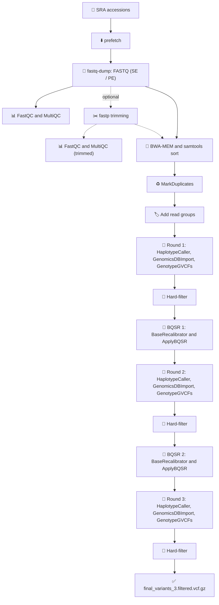

<div align="center">

# 🧬 VariFlow

**A reproducible Snakemake pipeline for SNP & indel discovery with iterative GATK base-quality recalibration**


</div>

---

## 📑 Table of contents

- [📖 Overview](#-overview)
- [✨ Key features](#-key-features)
- [🗺️ Workflow](#️-workflow)
- [🧩 Pipeline stages](#-pipeline-stages)
- [📁 Repository structure](#-repository-structure)
- [⚙️ Requirements](#️-requirements)
- [🛠️ Installation](#️-installation)
- [🔧 Configuration](#-configuration)
- [▶️ Usage](#️-usage)
- [📦 Output files](#-output-files)
- [🧹 Hard-filtering thresholds](#-hard-filtering-thresholds)
- [🧪 Testing on a small dataset](#-testing-on-a-small-dataset)
- [🔍 Troubleshooting](#-troubleshooting)
- [⚠️ Known limitations](#️-known-limitations)
- [📚 Citation](#-citation)
- [📝 License](#-license)
- [🙋 Contact](#-contact)

---

## 📖 Overview

**VariFlow** takes public **SRA run accessions** and a **reference genome** and produces a **filtered, jointly genotyped VCF** of SNPs and indels.

It is designed for **non-model organisms that have no known-variant database** (no dbSNP-style resource). GATK's BQSR needs a set of known variants, so VariFlow *bootstraps* one: variants called in one round are hard-filtered and used as the known-sites for the next, over three rounds of calling.

It was developed for ginger (*Zingiber officinale*, reference `GCF_018446385.1_Zo_v1.1`), but the reference genome and sample lists are set in a config file, so it can be reused for other species.

## ✨ Key features

- 🔁 **Iterative BQSR bootstrapping**: 3 rounds of calling with 2 rounds of recalibration
- 🧹 **Built-in hard-filtering** of SNPs and indels, used for the known-sites and the final VCF
- 🧬 **Mixed library types**: single-end (SE) and paired-end (PE) samples in one run, joint-genotyped together
- ⬇️ **Starts from accessions**: downloads from SRA, so no manual FASTQ handling
- ✂️ **Optional read trimming** with fastp (`trim_reads: true`)
- 📊 **Automatic QC**: FastQC and MultiQC reports for raw (and trimmed) reads
- 📦 **Reproducible software**: each rule runs in its own conda environment (`--use-conda`)
- 🧾 **Per-rule logs** for every step

## 🗺️ Workflow



## 🧩 Pipeline stages

| # | Stage | Tool | Rule file | Main output |
|---|-------|------|-----------|-------------|
| 1 | ⬇️ Download | SRA Toolkit `prefetch` | `download.smk` | `sra/<id>/<id>.sra` |
| 2 | 📄 Convert | `fastq-dump` | `fasterq.smk` | `fastq/` |
| 3 | ✂️ Trim *(optional)* | fastp | `trim.smk` | `trimmed/` |
| 4 | 📊 QC | FastQC, MultiQC | `fastqc_se.smk`, `fastqc_pe.smk`, `multiqc.smk` | `fastqc/`, `multiqc/` |
| 5 | 📚 Reference prep | BWA, samtools, GATK | `reference.smk` | `.bwt`, `.fai`, `.dict`, `.intervals` |
| 6 | 🔗 Align | BWA-MEM, samtools sort | `align.smk` | `aligned/<id>.sorted.bam` |
| 7 | ♻️ Deduplicate | GATK MarkDuplicates | `dedup.smk` | `aligned/<id>.markdup.bam` |
| 8 | 🏷️ Read groups | GATK AddOrReplaceReadGroups | `rg.smk` | `aligned/<id>.rg.bam` |
| 9 | 🧬 Round 1 calling | GATK HaplotypeCaller, GenomicsDBImport, GenotypeGVCFs | `gvcf_r1.smk` | `variants/final_variants_1.vcf.gz` |
| 10 | 🧹 Filtering | GATK SelectVariants, VariantFiltration, MergeVcfs | `filter.smk` | `*.filtered.vcf.gz` |
| 11 | 🎯 BQSR 1 | GATK BaseRecalibrator, ApplyBQSR | `bqsr.smk` | `bqsr1/<id>.recal.bam` |
| 12 | 🧬 Round 2 calling | GATK | `gvcf_r2.smk` | `variants_r2/final_variants_2.vcf.gz` |
| 13 | 🎯 BQSR 2 | GATK | `bqsr2.smk` | `bqsr2/<id>.recal.bam` |
| 14 | 🧬 Round 3 calling | GATK | `gvcf_r3.smk` | `variants_r3/final_variants_3.vcf.gz` |

## 📁 Repository structure

```
VariFlow/
├── 📄 README.md
├── 📄 LICENSE
├── 📄 .gitignore
├── 🐍 Snakefile                  # global settings, rule all, includes
├── ⚙️ config/
│   └── config.example.yaml       # copy to config.yaml (git-ignored)
├── 📦 envs/                      # conda environments
│   ├── bwa.yaml  samtools.yaml  gatk.yaml  sra.yaml  qc.yaml
└── 📜 rules/                     # one .smk file per stage
    ├── download.smk   fasterq.smk   trim.smk
    ├── fastqc_se.smk  fastqc_pe.smk multiqc.smk
    ├── reference.smk  align.smk     dedup.smk   rg.smk
    ├── gvcf_r1.smk    gvcf_r2.smk   gvcf_r3.smk
    ├── filter.smk
    └── bqsr.smk       bqsr2.smk
```

## ⚙️ Requirements

| Requirement | Notes |
|-------------|-------|
| 🐧 Linux | Developed on Ubuntu under WSL2 |
| 🐍 Conda or Mamba | [Miniforge](https://github.com/conda-forge/miniforge) recommended |
| 🐍 Snakemake | `<your version>`: install with `mamba install -c conda-forge -c bioconda snakemake` |
| 💾 Disk | Several hundred GB, depending on the number and size of samples |
| 🧠 Memory | GATK jobs use `-Xmx8G` by default (`java_mem`) and 8 threads |

Tools installed automatically per rule with `--use-conda`: BWA, samtools, GATK4, SRA Toolkit, FastQC, MultiQC, fastp.

Tool versions used for the reported results: `<fill in from conda list>`.

## 🛠️ Installation

```bash
git clone https://github.com/<your-username>/VariFlow.git
cd VariFlow
cp config/config.example.yaml config/config.yaml   # then edit it
```

## 🔧 Configuration

Edit `config/config.yaml`:

```yaml
reference: "/path/to/reference/genome.fna"
data_dir:  "/path/to/data_dir"

se_samples: [SRR_______]    # single-end SRA runs
pe_samples: [SRR_______]    # paired-end SRA runs

trim_reads: false
filter_known_sites: true
java_mem: "8G"
bqsr_max_cycle: 1000
```

| Key | Default | Description |
|-----|---------|-------------|
| `reference` | *(required)* | Reference FASTA. The BWA index, `.fai`, `.dict` and `.intervals` files are created next to it |
| `data_dir` | *(required)* | Directory for all downloads, intermediate files and results |
| `se_samples` | `[]` | SRA run accessions of single-end libraries |
| `pe_samples` | `[]` | SRA run accessions of paired-end libraries |
| `trim_reads` | `false` | `true`: align fastp-trimmed reads and also produce a trimmed-read MultiQC report |
| `filter_known_sites` | `true` | `true`: hard-filter the round 1 and 2 VCFs before using them as BQSR known-sites. `false`: use the raw VCFs |
| `java_mem` | `"8G"` | `-Xmx` value passed to GATK |
| `bqsr_max_cycle` | `1000` | `--maximum-cycle-value` for BaseRecalibrator |

> 💡 The **GenomicsDB intervals file** is generated automatically from the reference index and lists every contig. For genomes with thousands of scaffolds, restrict it to the main chromosomes to speed up GenomicsDBImport.

## ▶️ Usage

```bash
# 🔎 1. Dry run: check the job graph without running anything
snakemake -n --use-conda --cores 8

# 🚀 2. Full run
snakemake --use-conda --cores 8

# 🖼️ 3. Draw the DAG (needs graphviz)
snakemake --dag | dot -Tpng > docs/dag.png
```

**🔄 Resuming a long run**

```bash
snakemake --use-conda --cores 8 --rerun-incomplete --keep-going
```

**♻️ Re-using outputs you already have.** Snakemake re-runs a job when its code changes, which would re-run everything after you update the rules. To keep existing results and only run missing steps, check the plan first with:

```bash
snakemake -n --use-conda --cores 8 --rerun-triggers mtime
```

If the plan looks right, run the same command without `-n`.

## 📦 Output files

Everything is written under `data_dir`:

```
data_dir/
├── 📥 sra/                     downloaded .sra files
├── 📄 fastq/  trimmed/         raw and (optionally) trimmed reads
├── 📊 fastqc/  multiqc/        QC reports (plus *_trimmed versions)
├── 🔗 aligned/                 sorted, duplicate-marked, read-group BAMs
├── 🧬 variants/                round 1: gVCFs, GenomicsDB, final_variants_1[.filtered].vcf.gz
├── 🎯 bqsr1/                   recalibration tables and BAMs
├── 🧬 variants_r2/             round 2: gVCFs, final_variants_2[.filtered].vcf.gz
├── 🎯 bqsr2/                   second recalibration tables and BAMs
├── 🧬 variants_r3/             round 3: gVCFs, final_variants_3.vcf.gz
│                               and ✅ final_variants_3.filtered.vcf.gz  (final result)
├── 🧾 logs/                    one log per rule and sample
└── 🗑️ tmp/                     temporary files (safe to delete after a run)
```

## 🧹 Hard-filtering thresholds

Defined in `rules/filter.smk` (GATK generic recommendations). SNPs and indels are filtered separately, merged, and only **PASS** records are kept. MNP and MIXED records are dropped.

| Variant type | QD | FS | SOR | MQ | MQRankSum | ReadPosRankSum |
|--------------|----|----|-----|----|-----------|----------------|
| 🔹 SNP | < 2.0 | > 60.0 | > 3.0 | < 40.0 | < −12.5 | < −8.0 |
| 🔸 Indel | < 2.0 | > 200.0 | > 10.0 | not used | not used | < −20.0 |

> ⚠️ These are generic values. Check the annotation distributions of your own data before trusting them, especially with few samples.

## 🧪 Testing on a small dataset

Before a full run, test the pipeline end to end on a tiny dataset:

1. Use a small reference (a single chromosome or a subset of contigs).
2. Pick **one small SE and one small PE** SRA run (or subsample the FASTQs).
3. Put them in a separate config, for example `config/config.test.yaml`, with its own `data_dir`.
4. Run: `snakemake --use-conda --cores 4 --configfile config/config.test.yaml`

> 📝 *Status: not yet run end to end. Update this section with runtime and results once done.*

## 🔍 Troubleshooting

| Problem | Likely cause and fix |
|---------|----------------------|
| `MissingInputException` for the reference | Check that `reference` in `config.yaml` is a valid path to an existing FASTA |
| `conda: command not found` | Install Conda or Mamba and activate it before running with `--use-conda` |
| Everything wants to re-run after editing rules | Normal Snakemake behaviour (code change). Use `--rerun-triggers mtime` |
| GenomicsDBImport says the workspace exists | The rule deletes it first. If it still fails, remove the `db` directory by hand and retry |
| Out of memory in GATK steps | Lower `--cores` or adjust `java_mem` in the config |
| Disk full | Delete `tmp/`, old `.sra` files and intermediate BAMs you no longer need |
| `*:Zone.Identifier` files appear | Windows download markers. Delete them: `find . -name "*Zone.Identifier" -delete` |
| `paired files not generated` | The accession is probably single-end. Move it to `se_samples` |

## ⚠️ Known limitations

- 🧪 Validated by **dry run only**; a full end-to-end run on a test dataset is still pending.
- 🎚️ Hard-filter thresholds are generic GATK defaults and are not tuned to any organism.
- 🔁 BQSR round 2 recalibrates the round 1 recalibrated BAMs rather than the original BAMs.
- 🏷️ Final VCF is filtered but not annotated.
- 🐢 `fastq-dump` is used for SRA conversion (slower than `fasterq-dump`).
- 🧬 Read-group library and platform unit values are fixed (`lib1`, `unit1`).

## 📚 Citation

If you use VariFlow, please cite this repository and the tools it relies on:

```
<Your Name> (2026). VariFlow: a Snakemake pipeline for variant calling with iterative BQSR.
https://github.com/<your-username>/VariFlow
```

- **Snakemake**: Mölder et al., *F1000Research* 2021
- **GATK**: McKenna et al., *Genome Research* 2010
- **BWA**: Li & Durbin, *Bioinformatics* 2009
- **samtools**: Danecek et al., *GigaScience* 2021
- **fastp**: Chen et al., *Bioinformatics* 2018
- **MultiQC**: Ewels et al., *Bioinformatics* 2016
- **SRA Toolkit** and **FastQC**: cite per their documentation

## 📝 License

Released under the [MIT License](LICENSE). Add a `LICENSE` file to the repository root.

## 🙋 Contact

**<Your Name>** · 📧 <email> · 🐙 [@<your-username>](https://github.com/<your-username>)

Issues and suggestions are welcome via GitHub Issues.
